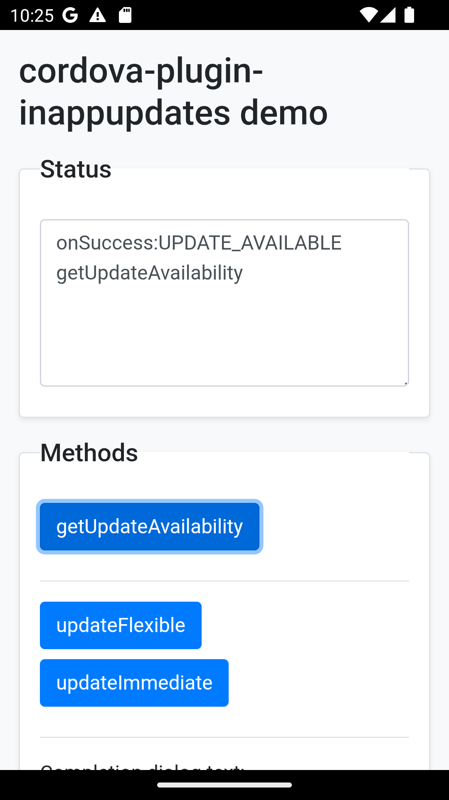
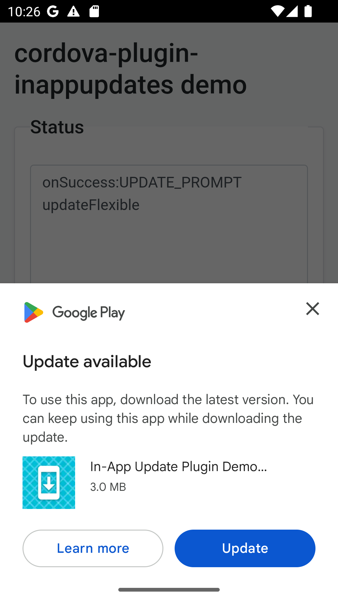
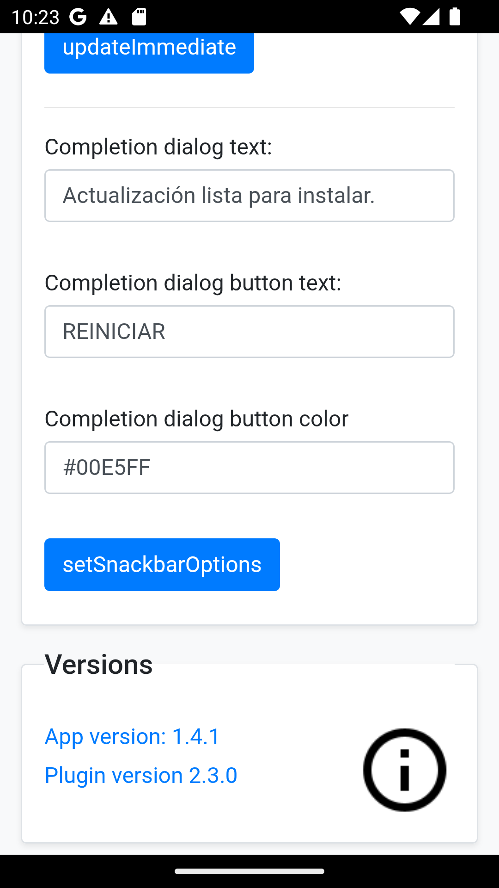
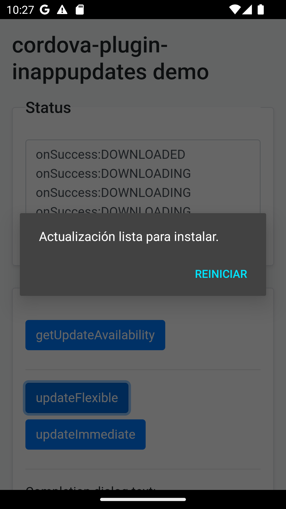
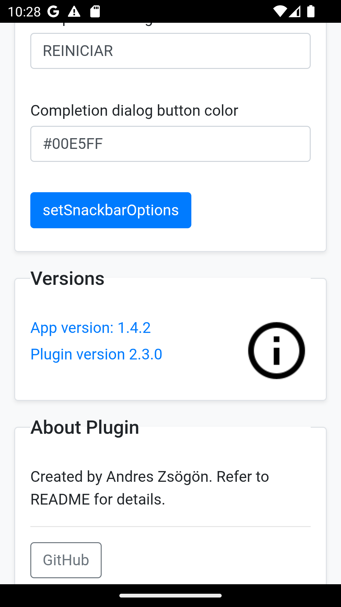

      

# cordova-plugin-in-app-updates

Cordova Android plugin for checking for updates and auto updating app with Google Play Store In-App updates API.

# Platforms

- Android
- Browser (filler platform)

# Features

- AndroidX ready (plugin version 2.x.x)
- Check for updates
- Install flexible updates
- Install immediate updates
- Customize the completion dialog message and button for flexible updates
- Customize the completion dialog button color for flexible updates

# Installation

## Plugin Versions

| Plugin version | Cordova >= | Cordova Android | AndroidX | targetSdkVersion |
| --- | --- | --- | --- | --- |
| 1.0.6 | 9.0.0 | 8.0.0 | No | 29 |
| 2.0.5 | 10.0.0 | 9.0.0 | Yes | 30/31 |
| 2.1.0 | 10.0.0 | 11.0.0 | Yes | 32 |
| 2.2.0 | 10.0.0 | 12.0.0 | Yes | 33 |
| 2.3.0 | 10.0.0 | 11.0.0 or later | Yes | 32 or later |

### Install latest version from NPM

```bash
  cordova plugin add cordova-plugin-in-app-updates
```

### Install latest version from master

```bash
  cordova plugin add https://github.com/andreszs/cordova-plugin-in-app-updates
```

# Methods

## getUpdateAvailability

Invokes the AppUpdateManager and return one of the [updateAvailability](https://developer.android.com/reference/com/google/android/play/core/install/model/UpdateAvailability.html) codes as string.

```javascript
cordova.plugins.InAppUpdate.getUpdateAvailability(successCallback, errorCallback)
```

### Return values

- **UPDATE_AVAILABLE**
- **UPDATE_NOT_AVAILABLE**
- **DEVELOPER_TRIGGERED_UPDATE_IN_PROGRESS**
- **UNKNOWN**

:information_source: Browser platform does nothing and always returns **UPDATE_NOT_AVAILABLE**

When this method returns **UPDATE_AVAILABLE**, your app is ready to use the following methods to prompt the user for update.

### Example

 ```javascript
var onSuccess = function (strSuccess) {
    console.log(strSuccess);
};
var onFailure = function (strError) {
    console.warn(strError);
};
cordova.plugins.InAppUpdate.getUpdateAvailability(onSuccess, onFailure);
```

## updateFlexible

Starts a [flexible update](https://developer.android.com/guide/playcore/in-app-updates/kotlin-java#flexible "flexible update") process and prompts the user with a dialog to download the new version now or when Wi-Fi is available.

```javascript
cordova.plugins.InAppUpdate.updateFlexible(successCallback, errorCallback)
```

:warning: The **successCallback** from this method can be triggered repeatedly according to its status.

### Return values

- **UPDATE_NOT_AVAILABLE**: No updates available in Play Store.
- **DEVELOPER_TRIGGERED_UPDATE_IN_PROGRESS**: Either flexible or immadiate update is in progress.
- **UPDATE_PROMPT**: The user has been presented with the Play Store dialog to download or ignore the flexible update.
- **RESULT_OK**: User accepted to download flexible update.
- **RESULT_CANCELED**: User declined the flexible update dialog or update was aborted while in progress.
- **RESULT_IN_APP_UPDATE_FAILED**: Something went wrong with the update dialog response.
- **ACTIVITY_RESULT_UNKNOWN**: Unknown result code returned by the dialog.
- **DOWNLOADING**: An update is currently being downloaded in the background.
- **DOWNLOADED**: The update was downloaded and the native completion dialog has been shown. Pressing its configured button calls `completeUpdate()`.

:information_source: Browser platform does nothing and always returns **UPDATE_NOT_AVAILABLE**

### Example

```javascript
var onSuccess = function (strSuccess) {
    console.log(strSuccess);
};
var onFailure = function (strError) {
    console.warn(strError);
};
cordova.plugins.InAppUpdate.updateFlexible(onSuccess, onFailure);
```

:warning: Make sure to call **getUpdateAvailability** as often as needed to ensure there are no **flexible** updates downloaded pending install, as they will consume storage space until installed.

## updateImmediate

Starts an [immediate update](https://developer.android.com/guide/playcore/in-app-updates/kotlin-java#immediate "immediate update") process and prompts the user with a fullscreen dialog to download now or when Wi-Fi is available. The update is downloaded and installed in the foreground, preventing the user from interacting with your app until the installation succeeds and the app is automatically restarted.

```javascript
cordova.plugins.InAppUpdate.updateImmediate(successCallback, errorCallback)
```

:warning: The **successCallback** from this method can be triggered repeatedly according to its status.

### Return values

- **UPDATE_NOT_AVAILABLE**: No updates available in Play Store.
- **DEVELOPER_TRIGGERED_UPDATE_IN_PROGRESS**: Either flexible or immadiate update is in progress.
- **RESULT_OK**: User accepted to download immediate update.
- **RESULT_CANCELED**: User declined the immediate update dialog.
- **RESULT_IN_APP_UPDATE_FAILED**: Something went wrong with the update dialog response.
- **ACTIVITY_RESULT_UNKNOWN**: Unknown result code returned by the dialog.
- **DOWNLOADING**: An update is currently being downloaded in the foreground.
- **DOWNLOADED**: The update was downloaded and will be installed immediately.

:information_source: Browser platform does nothing and always returns **UPDATE_NOT_AVAILABLE**

### Example

```javascript
var onSuccess = function (strSuccess) {
    console.log(strSuccess);
};
var onFailure = function (strError) {
    console.warn(strError);
};
cordova.plugins.InAppUpdate.updateImmediate(onSuccess, onFailure);
```

## setSnackbarOptions

Configures the message, button text, and button color for the completion prompt shown after downloading a flexible update. Since version 2.3.0, this prompt is a native, non-cancelable Android `AlertDialog` instead of a Material Snackbar.

The public method name `setSnackbarOptions()` is preserved for compatibility with existing applications. Its arguments now configure the completion dialog. You may call it at any time, including again after a previous completion prompt was shown.

```javascript
cordova.plugins.InAppUpdate.setSnackbarOptions(successCallback, errorCallback, completionText, completionButton, completionButtonColor)
```

:information_source: Browser platform does nothing and always returns **SUCCESS**

### Example

```javascript
var onSuccess = function (strSuccess) {
    console.log(strSuccess);
};
var onFailure = function (strError) {
    console.warn(strError);
};
var completionText = "An update has just been downloaded.";
var completionButton = "RESTART";
var completionButtonColor = "#76FF03";
cordova.plugins.InAppUpdate.setSnackbarOptions(onSuccess, onFailure, completionText, completionButton, completionButtonColor);
```

### Completion dialog default values

 If this method is not called, default messages in English will be shown as follows.

- **completionText** = "An update has just been downloaded."
- **completionButton** = "RESTART"
- **completionButtonColor** = "#76FF03"

### Return values

- **onSuccess** = "SUCCESS"
- **onFail** = *Internal error description.*

# Plugin demo app

- [Compiled APK and reference](https://www.andreszsogon.com/cordova-in-app-update-plugin-demo-app/) including testing procedure instructions
- [Latest demo app version in Play Store](https://play.google.com/store/apps/details?id=com.andreszs.inappupdate.demo)
- [Source code for www folder](https://github.com/andreszs/cordova-plugin-demos)

The screenshots below show an end-to-end flexible update using plugin 2.3.0. Version 1.4.1 of the demo was installed from Google Play, version 1.4.2 was offered as an update, and accepting the native completion dialog installed and relaunched the updated app.

| Demo and configuration | Update availability | Google Play flexible prompt |
| --- | --- | --- |
|  |  |  |
| Completion dialog options | Native completion dialog | Updated demo app |
|  |  |  |

The legacy `setSnackbarOptions()` method configures the message, button text, and button color shown in the native completion dialog. Pressing the configured button calls `completeUpdate()`.

# Contribute

Bug reports and pull requests are welcome. If this plugin is useful in your apps, you can also support its continued development and maintenance through PayPal.

[Contribute via PayPal](https://www.paypal.com/ncp/payment/GEEM324PDD9NC)

If you cannot contribute financially, starring the repository also helps improve its visibility.

# Changelog

### 2.3.0

- Replaced the Material Snackbar used after a flexible update download with a native Android `AlertDialog`.
- Removed the explicit Material Components and AppCompat dependencies.
- Preserved the existing JavaScript `setSnackbarOptions()` API; its values now configure the completion dialog.
- Restored compatibility with cordova-android 11 or later.

### 2.2.0

- Optimized for android-compileSdkVersion 33
- Minimum cordova-android version set to 12
- Updated androidx.appcompat:appcompat to 1.6.1
- Updated com.google.android.material:material to 1.8.0

### 2.1.0

- Optimized for android-compileSdkVersion 32
- Minimum cordova-android version set to 11
- Replaced com.google.android.play:core with the standalone [Play In-App Updates Library](https://developer.android.com/reference/com/google/android/play/core/release-notes-in_app_updates "Play In-App Updates Library") 2.1.0
- Updated androidx.appcompat:appcompat to 1.5.1
- Updated com.google.android.material:material to 1.3.0
- Removed the `edit-config` rule that was setting `android:theme="@style/Theme.AppCompat.NoActionBar"`
- Tested on Android 5.1, 8.1, 10.

### 2.0.5

- Optimized for android-compileSdkVersion 30
- Updated androidx.appcompat:appcompat to 1.3.0
- Updated com.google.android.play:core to 1.8.0
- Updated com.google.android.material:material to 1.2.0
